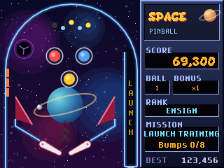
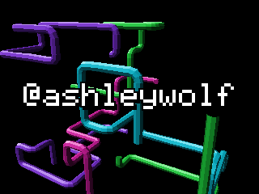
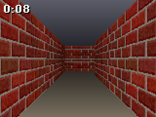
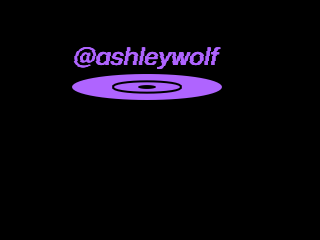
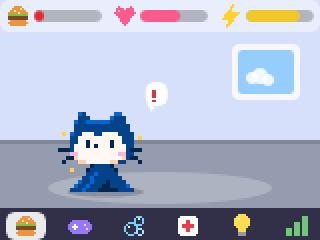
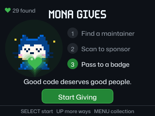

# Badge apps

These are my apps for the GitHub Universe 2026 badge (Badger 2350). Each folder
under `apps/` is one app.

## Apps

<table>
<tr>
<td width="50%" valign="top">
 
<b><a href="apps/space_pinball">Space Pinball</a></b> 
Lean the badge to roll the ball around a space pinball table, inspired by 3D Pinball: Space Cadet.
</td>
<td width="50%" valign="top">
 
<b><a href="apps/windows_pipes">Windows Pipes</a></b> 
Glossy 3D pipes grow behind my floating name, like the Windows 3D Pipes screensaver.
</td>
</tr>
<tr>
<td width="50%" valign="top">
 
<b><a href="apps/maze3d">3D Maze</a></b> 
Walk through a red brick labyrinth by tilting and turning the badge.
</td>
<td width="50%" valign="top">
 
<b><a href="apps/ski_tilt">Ski Tilt</a></b> 
Tilt the badge to steer a skier downhill, SkiFree-style.
</td>
</tr>
<tr>
<td width="50%" valign="top">
 
<b><a href="apps/bouncing_logo">Bouncing Logo</a></b> 
A handle bounces around the screen like the classic DVD screensaver.
</td>
<td width="50%" valign="top">
 
<b><a href="apps/gitgotchi">GitGotchi</a></b> 
Hatch and raise Mona, a rubber duck, the ship-it squirrel, or Copilot as a virtual pet.
</td>
</tr>
<tr>
<td width="50%" valign="top">
 
<b><a href="apps/mona_gives">Mona Gives</a></b> 
Meet open source maintainers, open their GitHub Sponsors page by QR code, and pass the heart to another badge.
</td>
</tr>
</table>

Each app's README lists its controls.

## Install an app

1. Plug the badge into your computer with USB.
2. Put the badge in USB disk mode. A drive named `BADGER` appears.
3. Copy an app folder, for example `apps/space_pinball`, into the `apps/`
   folder on the `BADGER` drive.
4. Eject the drive and reset the badge. The app shows up in the menu.

These apps need the October 2026 badge firmware. They use the badge's built-in
`badge`, `screen`, and button globals, so they don't run on the 2025 badge.

## Credits

I wrote all the code and drew most of the art in code. GitGotchi and Mona Gives
use Mona and squirrel sprites from [badger/home](https://github.com/badger/home)
under the MIT License, and Mona Gives shows maintainers' public GitHub avatars.
The apps borrow ideas from classic games and screensavers, but
they include no graphics, sounds, or code from them.

Made for the [GitHub Universe badge](https://github.com/badger/home).
